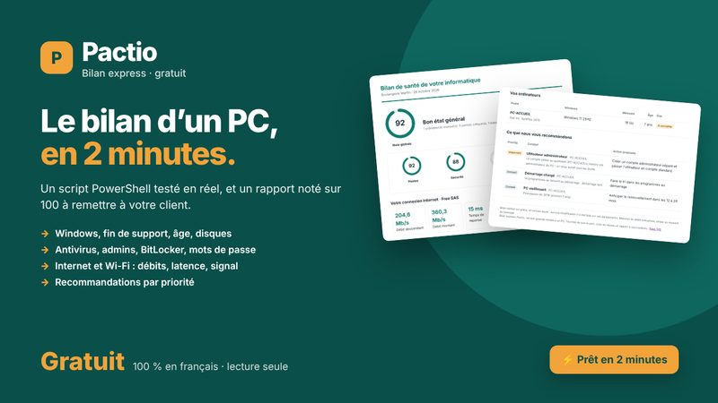

# Bilan express — le bilan de santé d'un PC Windows en 2 minutes



Script PowerShell **gratuit**, en français, pour les informaticiens qui interviennent chez des TPE.
Il analyse un PC Windows et produit un **rapport noté sur 100**, lisible par le client, avec les recommandations par priorité.

**Lecture seule : rien n'est modifié sur le PC.** Le script lit, mesure, et écrit uniquement son rapport.

## Ce qui est vérifié

| Thème | Contrôles |
|---|---|
| Poste | Version de Windows et date de fin de support, âge estimé, mémoire, disques, démarrage, mises à jour, redémarrage en attente, batterie |
| Sécurité | Antivirus et Defender, pare-feu, administrateurs, comptes sans mot de passe, Bureau à distance, UAC, BitLocker, SMBv1 |
| Internet et Wi-Fi | Latence, pertes, débits descendant et montant, signal Wi-Fi |

## Lancer le bilan

1. Copiez `Bilan-Express.ps1` sur une clé USB ou dans `C:\Pactio` sur le PC à analyser.
2. Ouvrez PowerShell (en administrateur si possible : le bilan est plus complet).
3. Lancez :

```powershell
cd C:\Pactio
Set-ExecutionPolicy -Scope Process Bypass -Force
.\Bilan-Express.ps1 -Client "Boulangerie Martin"
```

4. Ouvrez `Bilan_Boulangerie Martin\Rapport_Bilan_Sante.html`, puis Ctrl+P pour en faire un PDF.

**Ou en une commande**, depuis la [PowerShell Gallery](https://www.powershellgallery.com/packages/Bilan-Express) :

```powershell
Install-Script -Name Bilan-Express -Scope CurrentUser
Set-ExecutionPolicy -Scope Process Bypass -Force
Bilan-Express.ps1 -Client "Boulangerie Martin"
```

Installé ainsi, le rapport s'enregistre sur le Bureau.

`Set-ExecutionPolicy -Scope Process` ne vaut que pour la fenêtre ouverte. Option : `-SansDebit` pour ne pas mesurer le débit (30 secondes de gagnées).

Prérequis : Windows 10 ou 11, PowerShell 5.1. Aucun module à installer. Le guide de démarrage illustré est dans `Bilan-Express_Demarrage.pdf`.

## Aller plus loin

Le Bilan express est limité à un PC. Le **[Pack TPE](https://pactiofr.gumroad.com/l/pack-tpe)** (39 €) ajoute :

- la tournée de tous les PC du client, réunis dans un seul rapport ;
- le scan du réseau (box, NAS, imprimantes, caméras, ports à risque) ;
- l'option serveur et domaine Active Directory ;
- la migration vers un nouveau PC (fichiers, navigateurs, Outlook, imprimantes, logiciels) ;
- votre logo et vos couleurs sur le rapport, et des procédures PDF illustrées.

Les autres outils Pactio (GPO pour TPE, audit Microsoft 365 et Intune, contrats de maintenance) : **[pactiofr.gumroad.com](https://pactiofr.gumroad.com)**

## Licence

Usage libre, y compris chez vos clients. Redistribution interdite. Fourni en l'état, à tester sur un périmètre restreint avant un usage général.

Pactio est un nom commercial de Sébastien Mastain EI, administrateur systèmes et réseaux depuis 27 ans (Isère).
